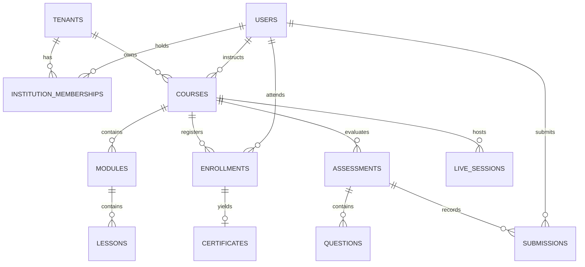
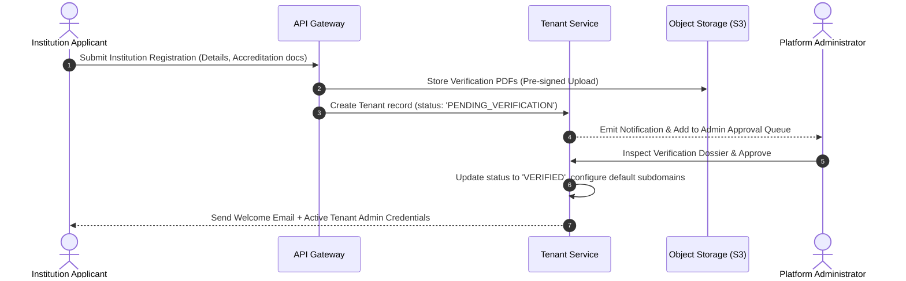
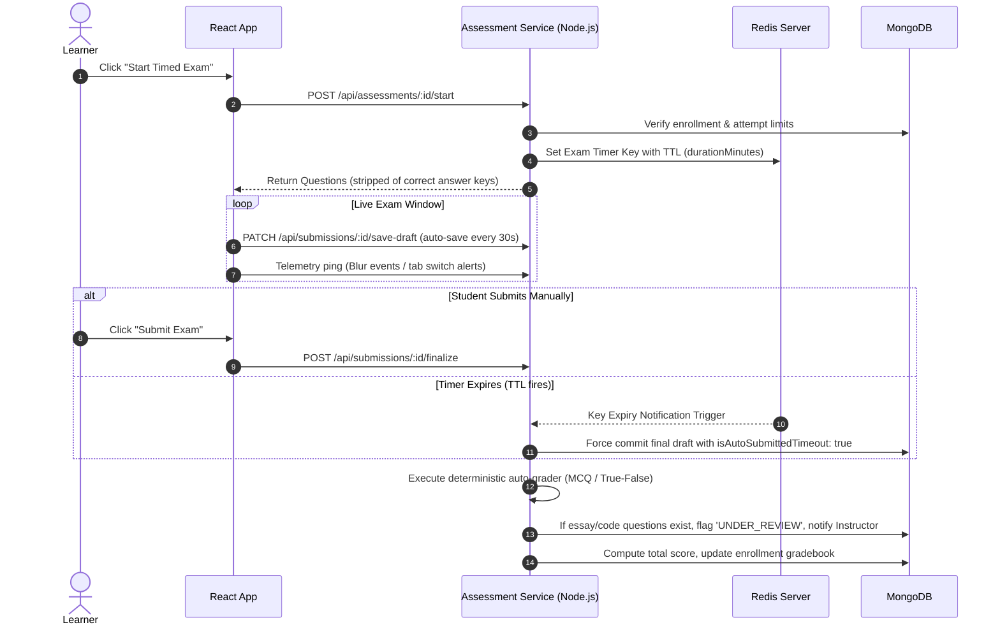
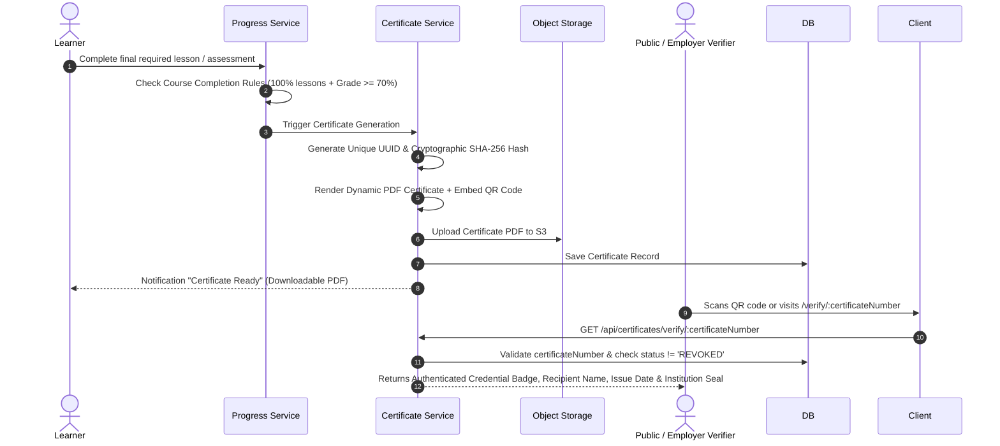

# EduSphere Architecture & Design Specification
**Platform:** Secure, Scalable, and Interoperable Web-Based E-Learning Platform  
**Target Architecture:** React + TypeScript (Frontend), Node.js + Express + TypeScript (Backend), MongoDB (Database Cluster)  
**Document Version:** 1.0.0-DRAFT  
**Date:** October 2026  

---

## 1. Executive Summary & Architectural Vision

**EduSphere** is engineered as an enterprise-grade, multi-tenant digital learning ecosystem catering to two primary operational models:
1. **Institutional Tier:** Universities, schools, and corporate training academies requiring strict tenant isolation, branded spaces, institutional course governance, staff/faculty management, and academic compliance.
2. **Independent Tier:** Self-directed learners and independent subject matter experts creating, publishing, and enrolling in public open courses.

The platform architecture strictly guarantees **defense-in-depth security**, **sub-second database read latencies**, **horizontal scalability**, and **seamless interoperability** with external educational ecosystems (via LTI 1.3, SCORM/xAPI, and cryptographic QR-verified certificates).

---

## 2. End-to-End System Architecture

```mermaid
graph TB
    subgraph Client_Tier["Client Tier (React 18+ / TypeScript / Modern Responsive UI)"]
        UI_Learner["Learner Portal (Web & Mobile PWA)"]
        UI_Teacher["Instructor Studio & Exam Builder"]
        UI_InstAdmin["Institution Admin Console"]
        UI_SuperAdmin["Platform SuperAdmin Operations"]
        UI_Classroom["Real-Time Live WebRTC Classroom"]
    end

    subgraph Edge_Security["Edge & Security Gateway"]
        CDN["Global CDN (Cloudflare / CloudFront)"]
        WAF["Web Application Firewall & DDoS Shield"]
        Proxy["Nginx / Reverse Proxy (SSL/TLS 1.3 Termination)"]
        RateLimiter["Redis-Backed Token Bucket Rate Limiter"]
    end

    subgraph API_Services["Application Core (Node.js + Express + TypeScript)"]
        AuthService["Auth & IAM Service (JWT, MFA, OAuth2, RBAC/ABAC)"]
        TenantService["Tenant Context & Isolation Middleware"]
        CourseService["Course & Curriculum Engine"]
        ExamService["Assessment & Auto-Grading Engine"]
        CertService["Certificate & Cryptographic Verification Service"]
        AuditService["Security & Compliance Audit Logger"]
    end

    subgraph RealTime_Tier["Real-Time & Media Subsystems"]
        SFU["WebRTC SFU Cluster (LiveKit / Mediasoup)"]
        SocketCluster["Socket.io WebSocket Cluster (Chat, Hand-raising, Telemetry)"]
        Transcoder["Async Video Transcoder & HLS Packager"]
    end

    subgraph Storage_Tier["Data & Cache Persistence"]
        MongoDB[("MongoDB 7.0 Cluster (Replica Set + Sharding)")\n- Tenant Partitioning\n- Compound Indexes\n- Document Versioning]
        Redis[("Redis 7.x Cluster")\n- Session Cache\n- BullMQ Task Queues\n- Real-time Leaderboards & Telemetry]
        ObjectStorage[("S3-Compatible Object Storage (MinIO / AWS S3)")\n- Course Assets & Lesson Videos\n- Student Submissions\n- PDF Certificates & Verification Documents]
    end

    Client_Tier --> Edge_Security
    Edge_Security --> API_Services
    Client_Tier <--> RealTime_Tier
    API_Services --> MongoDB
    API_Services --> Redis
    API_Services --> ObjectStorage
    RealTime_Tier --> Redis
    RealTime_Tier --> ObjectStorage
```

### 2.1 Multi-Tenancy Architecture Pattern
To achieve strict data security without the DevOps overhead of maintaining hundreds of discrete databases, EduSphere utilizes a **Shared Database, Logical Tenant Partitioning with Strict Middleware Context Propagation**:
- **Tenant Context Resolution:** Every request passing through the API Gateway resolves the tenant via Subdomain (`tenant1.edusphere.io`), Custom Domain (`lms.university.edu`), or HTTP Header (`X-Tenant-ID`).
- **AsyncLocalStorage Isolation:** Node.js `AsyncLocalStorage` retains the resolved `tenantId` and active user context throughout the asynchronous lifecycle of the HTTP request.
- **Mongoose Tenant Plugin:** All multi-tenant collections automatically enforce `{ tenantId: currentTenantId }` filter criteria on every `find`, `update`, `count`, and `delete` query, preventing data leakage across tenant boundaries.
- **Independent / Public Courses:** Independent courses operate under a reserved global tenant (`tenantId: null` or `tenantId: 'GLOBAL'`), allowing public learners to enroll without institutional affiliation.

---

## 3. MongoDB Database Architecture (Schemas & Indexes)

EduSphere models relationships using optimized MongoDB documents, embedding frequently co-read items while referencing high-volume or independently lifecycle-managed entities.



### 3.1 Core Collections Specification

#### 1. `tenants` (Institutions & Independent Providers)
```typescript
interface ITenant {
  _id: ObjectId;
  name: string;
  slug: string; // e.g., 'stanford-edu'
  domains: string[]; // ['lms.stanford.edu']
  type: 'UNIVERSITY' | 'K12_SCHOOL' | 'TRAINING_CENTER' | 'INDEPENDENT_PROVIDER';
  status: 'PENDING_VERIFICATION' | 'VERIFIED' | 'SUSPENDED' | 'REJECTED';
  verificationDocuments: Array<{
    documentType: string;
    fileUrl: string;
    uploadedAt: Date;
    verifiedAt?: Date;
  }>;
  branding: {
    logoUrl: string;
    primaryColor: string;
    secondaryColor: string;
    bannerUrl?: string;
  };
  settings: {
    allowIndependentEnrollment: boolean;
    requireEnrollmentApproval: boolean;
    maxStorageQuotaGb: number;
    enabledFeatures: string[]; // ['LIVE_CLASSES', 'PROCTORING', 'SCORM']
  };
  createdAt: Date;
  updatedAt: Date;
}
// Indexes: { slug: 1 } (Unique), { domains: 1 }, { status: 1 }
```

#### 2. `users` (Global Identity & Credentials)
```typescript
interface IUser {
  _id: ObjectId;
  email: string; // Lowercase, unique
  passwordHash: string; // Argon2id or bcrypt (salt rounds 12)
  fullName: string;
  avatarUrl?: string;
  bio?: string;
  globalRole: 'PLATFORM_SUPERADMIN' | 'STANDARD_USER';
  security: {
    isEmailVerified: boolean;
    emailVerificationToken?: string;
    passwordResetToken?: string;
    passwordResetExpires?: Date;
    twoFactorEnabled: boolean;
    twoFactorSecret?: string;
    failedLoginAttempts: number;
    lockoutUntil?: Date;
  };
  preferences: {
    locale: string;
    timezone: string;
    notificationChannels: { email: boolean; push: boolean; inApp: boolean };
  };
  createdAt: Date;
  updatedAt: Date;
}
// Indexes: { email: 1 } (Unique), { 'security.emailVerificationToken': 1 }
```

#### 3. `institution_memberships` (Multi-Role Context per Tenant)
```typescript
interface IInstitutionMembership {
  _id: ObjectId;
  tenantId: ObjectId; // Ref: tenants
  userId: ObjectId;   // Ref: users
  role: 'INSTITUTION_ADMIN' | 'INSTRUCTOR' | 'STUDENT' | 'TEACHING_ASSISTANT';
  status: 'INVITED' | 'PENDING_APPROVAL' | 'ACTIVE' | 'SUSPENDED';
  studentIdentifier?: string; // Institutional Student/Staff ID
  department?: string;
  permissionsOverride: string[]; // Granular custom capability overrides
  joinedAt: Date;
  createdAt: Date;
}
// Indexes: { tenantId: 1, userId: 1 } (Unique compound), { userId: 1 }, { tenantId: 1, role: 1 }
```

#### 4. `courses` (Curriculum & Enrollment Settings)
```typescript
interface ICourse {
  _id: ObjectId;
  tenantId?: ObjectId | null; // Null if Independent Public Course
  title: string;
  slug: string;
  tagline: string;
  description: string; // Markdown/HTML
  category: string;
  level: 'BEGINNER' | 'INTERMEDIATE' | 'ADVANCED' | 'ALL_LEVELS';
  instructors: ObjectId[]; // Primary & Co-instructors (Ref: users)
  thumbnailUrl: string;
  previewVideoUrl?: string;
  visibility: 'PUBLIC' | 'INSTITUTION_RESTRICTED' | 'PRIVATE_INVITE_ONLY';
  enrollmentMode: 'FREE' | 'PAID' | 'APPROVAL_REQUIRED';
  pricing?: {
    amount: number;
    currency: string;
  };
  completionCriteria: {
    minimumLessonCompletionPct: number; // e.g. 100%
    requiredAssessmentIds: ObjectId[];
    minimumPassingGradePct: number; // e.g. 70%
  };
  isPublished: boolean;
  publishedAt?: Date;
  isArchived: boolean;
  stats: {
    enrolledCount: number;
    ratingAverage: number;
    ratingCount: number;
  };
  createdAt: Date;
  updatedAt: Date;
}
// Indexes: { tenantId: 1, isPublished: 1 }, { visibility: 1, category: 1 }, { slug: 1, tenantId: 1 }
```

#### 5. `modules` & `lessons` (Course Structure)
```typescript
interface IModule {
  _id: ObjectId;
  courseId: ObjectId;
  title: string;
  order: number;
  description?: string;
}

interface ILesson {
  _id: ObjectId;
  courseId: ObjectId;
  moduleId: ObjectId;
  title: string;
  order: number;
  contentType: 'VIDEO' | 'DOCUMENT' | 'INTERACTIVE_QUIZ' | 'SCORM_PACKAGE' | 'LIVE_CLASS_REF';
  contentPayload: {
    videoDurationSec?: number;
    streamUrl?: string; // HLS playlist (.m3u8)
    bodyMarkdown?: string;
    attachmentUrls?: Array<{ fileName: string; fileUrl: string; fileSize: number }>;
    scormManifestUrl?: string;
  };
  isFreePreview: boolean;
}
// Indexes: { courseId: 1, moduleId: 1, order: 1 }
```

#### 6. `enrollments` & `progress`
```typescript
interface IEnrollment {
  _id: ObjectId;
  tenantId?: ObjectId | null;
  courseId: ObjectId;
  learnerId: ObjectId; // Ref: users
  status: 'PENDING_APPROVAL' | 'ENROLLED' | 'COMPLETED' | 'DROPPED';
  enrolledAt: Date;
  completedAt?: Date;
  progress: {
    overallPercentage: number;
    completedLessons: Array<{
      lessonId: ObjectId;
      completedAt: Date;
      timeSpentSeconds: number;
    }>;
    lastAccessedLessonId?: ObjectId;
  };
  finalGrade?: {
    scorePct: number;
    passed: boolean;
    computedAt: Date;
  };
  certificateIssued: boolean;
  certificateId?: ObjectId;
}
// Indexes: { courseId: 1, learnerId: 1 } (Unique), { learnerId: 1, status: 1 }
```

#### 7. `live_sessions` (Virtual Classrooms & Attendance)
```typescript
interface ILiveSession {
  _id: ObjectId;
  tenantId?: ObjectId | null;
  courseId: ObjectId;
  hostInstructorId: ObjectId;
  title: string;
  description?: string;
  scheduledStartTime: Date;
  durationMinutes: number;
  status: 'SCHEDULED' | 'LIVE' | 'CONCLUDED' | 'CANCELLED';
  roomConfig: {
    roomId: string;
    recordingEnabled: boolean;
    chatEnabled: boolean;
    screenShareAllowedRoles: ('INSTRUCTOR' | 'ALL')[];
  };
  recordingUrl?: string;
  attendanceRecords: Array<{
    userId: ObjectId;
    joinedAt: Date;
    leftAt?: Date;
    durationMinutes: number;
  }>;
}
// Indexes: { courseId: 1, scheduledStartTime: 1 }, { hostInstructorId: 1 }
```

#### 8. `assessments`, `questions`, and `submissions`
```typescript
interface IAssessment {
  _id: ObjectId;
  courseId: ObjectId;
  title: string;
  type: 'QUIZ' | 'ASSIGNMENT' | 'MIDTERM' | 'FINAL_EXAM';
  instructions: string;
  durationMinutes: number; // 0 = untimed
  maxAttempts: number;
  passingScorePct: number;
  scheduleWindow: {
    availableFrom: Date;
    availableUntil: Date;
  };
  securitySettings: {
    shuffleQuestions: boolean;
    shuffleOptions: boolean;
    detectTabSwitch: boolean;
    browserLockdownRequired: boolean;
  };
  weightagePct: number; // Contribution to final course mark
}

interface IQuestion {
  _id: ObjectId;
  assessmentId: ObjectId;
  type: 'MULTIPLE_CHOICE' | 'MULTIPLE_RESPONSE' | 'TRUE_FALSE' | 'SHORT_ANSWER' | 'ESSAY' | 'CODE';
  prompt: string;
  options?: Array<{ id: string; text: string }>;
  correctAnswerKeys?: string[]; // Kept hidden from student responses
  rubricCriteria?: string;
  points: number;
  order: number;
}

interface ISubmission {
  _id: ObjectId;
  assessmentId: ObjectId;
  courseId: ObjectId;
  learnerId: ObjectId;
  attemptNumber: number;
  startedAt: Date;
  submittedAt: Date;
  isAutoSubmittedTimeout: boolean;
  answers: Array<{
    questionId: ObjectId;
    learnerResponse: any;
    pointsAwarded?: number;
    autoGraded: boolean;
    instructorFeedback?: string;
    gradedBy?: ObjectId;
  }>;
  totalScoreEarned: number;
  totalScoreMax: number;
  status: 'IN_PROGRESS' | 'SUBMITTED' | 'UNDER_REVIEW' | 'GRADED';
  proctoringFlags: Array<{
    type: 'TAB_BLUR' | 'FULLSCREEN_EXIT' | 'IP_MISMATCH';
    timestamp: Date;
  }>;
}
// Indexes: { assessmentId: 1, learnerId: 1, attemptNumber: 1 }, { courseId: 1, learnerId: 1 }
```

#### 9. `certificates` (Cryptographic Verification Engine)
```typescript
interface ICertificate {
  _id: ObjectId;
  certificateNumber: string; // e.g. "EDU-2026-X89K-4921"
  verificationHash: string;  // SHA-256 (learnerId + courseId + completionDate + secretSalt)
  tenantId?: ObjectId | null;
  courseId: ObjectId;
  learnerId: ObjectId;
  recipientName: string;
  courseTitle: string;
  institutionName?: string;
  issueDate: Date;
  gradePct?: number;
  pdfStorageUrl: string;
  qrCodeUrl: string;
  publicVerificationUrl: string;
  status: 'ACTIVE' | 'REVOKED';
  revocationReason?: string;
  revokedAt?: Date;
  revokedBy?: ObjectId;
}
// Indexes: { certificateNumber: 1 } (Unique), { verificationHash: 1 } (Unique), { learnerId: 1 }
```

#### 10. `audit_logs`
```typescript
interface IAuditLog {
  _id: ObjectId;
  tenantId?: ObjectId | null;
  actorId: ObjectId;
  actorEmail: string;
  action: string; // e.g. 'COURSE_PUBLISH', 'GRADE_OVERRIDE', 'CERTIFICATE_REVOKE', 'USER_ROLE_CHANGE'
  resourceType: string;
  resourceId: string;
  previousState?: any;
  newState?: any;
  ipAddress: string;
  userAgent: string;
  timestamp: Date;
}
// Indexes: { tenantId: 1, timestamp: -1 }, { actorId: 1 }, { resourceId: 1 }
```

---

## 4. User Roles & Granular Permissions Matrix

| Functional Module | Platform Admin | Institution Admin | Teacher / Instructor | Learner / Student | Independent Learner | Video Service (System) |
| :--- | :---: | :---: | :---: | :---: | :---: | :---: |
| **Verify / Manage Institutions** | Full | None | None | None | None | None |
| **Manage Tenant Settings & Staff** | Full | Tenant-Only | None | None | None | None |
| **Course Creation & Publishing** | System-Wide | Tenant-Scoped | Owned Courses | None | None | None |
| **Enrollment Request Approval** | System-Wide | Tenant-Scoped | Assigned Courses | None | None | None |
| **Study Content & Track Progress** | Preview Only | Preview Only | Preview Only | Enrolled Only | Enrolled Only | None |
| **Schedule & Host Live Classrooms** | Monitor | Tenant-Scoped | Assigned Courses | Attend Only | Attend Only | Host/Relay Media |
| **Create Exams & Grade Submissions** | System-Wide | Tenant-Scoped | Assigned Courses | Submit Only | Submit Only | None |
| **Generate & Issue Certificates** | Platform Level | Tenant Level | Assigned Courses | View & Download | View & Download | None |
| **Revoke Certificates** | Full | Tenant-Only | Needs Admin OK | None | None | None |
| **Public Certificate Verification** | Public | Public | Public | Public | Public | Public |
| **Audit Logs & Academic Reporting** | Platform Logs | Tenant Logs | Course Logs | Own Grades | Own Grades | Append Telemetry |

---

## 5. Main End-to-End Workflows

### 5.1 Institution Onboarding & Verification Workflow


### 5.2 Assessment, Timed Auto-Submission, and Grading Workflow


### 5.3 Automated Certificate Issuance & QR Verification Workflow


---

## 6. Modern Responsive UI/UX Design System (EduSphere)

Reflecting the visual design presented in the system mockups:

### 6.1 Design Tokens & Style Guide
- **Color Palette:**
  - **Primary Brand:** `#2563EB` (Royal Blue) & `#1D4ED8` (Deep Blue Hover)
  - **Secondary Neutral:** `#64748B` (Slate Grey) & `#334155` (Slate Dark)
  - **Background Surfaces:** `#F8FAFC` (Canvas Light), `#FFFFFF` (Card White), `#0F172A` (Sidebar Navy / Dark Accent)
  - **Functional Accents:** `#10B981` (Emerald Success), `#F59E0B` (Amber Warning), `#EF4444` (Rose Danger), `#8B5CF6` (Purple Certificate Accent)
- **Typography:**
  - Font Family: `Inter`, `-apple-system, BlinkMacSystemFont, "Segoe UI", Roboto, sans-serif`
  - Hierarchy: Display 36px (SemiBold), Headings 28/24/20px, Body 16/14px, Captions 12px
- **Layout & Elevation:**
  - Multi-tier sidebar layout with collapsible high-density navigation.
  - Glassmorphism header bars (`backdrop-filter: blur(12px); background: rgba(255,255,255,0.85)`).
  - Modern card radius (`12px` to `16px`) with soft ambient shadows (`0 4px 20px -2px rgba(0, 0, 0, 0.05)`).

### 6.2 Screen Inventory (8 Core Mockups + Specialized Views)
1. **Landing / Home Page:** Global navigation with role-specific CTAs, audience segment selector (Schools, Universities, Training Centers, Independent Learners), search discovery bar, popular courses catalog, and social proof counters (50K+ Learners, 1K+ Courses, 200+ Institutions).
2. **Authentication & Sign-in Portal:** Split-screen layout. Left side: deep royal blue brand storytelling with 3D graduation cap visual; Right side: login card supporting email/password, "Remember Me", forgot password recovery, and single-click SSO (Google, Microsoft 365).
3. **Learner Dashboard:** Personalized dynamic greeting header ("Hello, <User> 👋"), 4 live KPI cards (Enrolled Courses, Completed, Certificates, Active Progress %), "Continue Learning" active course cards with inline progress indicators, and recommended courses.
4. **Course Detail Page:** Immersive dark hero banner, breadcrumbs, rating and enrollment badges, dynamic tabbed interface (Overview, Curriculum accordion, Instructors, Student Reviews), and sticky enrollment sidebar card with live "Enroll Now" / "Go to My Courses" CTA.
5. **My Courses View:** Dynamic segmented filter tabs (All Enrolled, Completed, In-Progress), rich cards with thumbnails, category chips, visual progress bars, and high-contrast "Continue" action buttons.
6. **Instructor Studio & Course Builder:** 4-stage stepper wizard (`1. Basic Info` -> `2. Content & Curriculum` -> `3. Settings & Grading` -> `4. Publish`), rich media upload dropzones, and structured curriculum outline builder.
7. **Institution Registration & Tenant Onboarding:** Multi-step compliance form collecting organization metadata, institution type, administrative contacts, and accreditation document dropzone.
8. **Platform & Institutional Admin Dashboard:** High-level metric overview cards (Total Institutions, Total Users, Active Courses, Active Learners), institutional verification pending review table, and live security/activity audit stream.
9. **Integrated Live Classroom Interface:** Dual-pane layout featuring WebRTC multi-grid video, screen share canvas, raise-hand notifications, real-time participant roster, and synchronized in-room chat.
10. **Exam & Assessment Player:** Distraction-free full-screen testing interface, persistent countdown timer, question navigator palette (Answered, Flagged, Unvisited), and automatic timeout submit modal.
11. **Public Certificate Verification Portal:** Accessible URL / QR target displaying authenticated badge, verified recipient details, issuing institution stamp, cryptographic hash, and 1-click PDF download.

---

## 7. Enterprise Extended Subsystems (User-Ratified Scope)

Following review, the following four mission-critical subsystems are officially incorporated into the EduSphere architecture:

### 7.1 Anti-Cheating & Exam Integrity Subsystem
- **Browser Event Interceptor:** React assessment wrapper monitors `document.visibilitychange`, window blur events, and secondary monitor detachment. Exits from fullscreen trigger an immediate audit entry.
- **Copy/Paste & Right-Click Disabling:** Keyboard event interceptors block clipboard shortcuts (`Ctrl+C`, `Ctrl+V`, `Cmd+C`, `Cmd+V`, context menu).
- **Randomized Question Banking:** Exams define rules (e.g., "Select 20 questions randomly from Category: Data Structures with difficulty: Medium"). Each candidate receives a distinct, randomized permutation of questions and shuffled multiple-choice options.
- **IP & Geolocation Lock:** Enforces single active session per exam token; concurrent logins terminate the previous attempt.

### 7.2 Adaptive HLS Video Transcoding Pipeline
- **Upload Flow:** Instructors upload MP4/MOV lessons directly to S3 via pre-signed chunked upload URLs.
- **Worker Processing:** BullMQ worker triggers FFmpeg to transcode source video into adaptive bitrate variants:
  - 1080p (4500 kbps)
  - 720p (2200 kbps)
  - 480p (800 kbps)
  - 360p (400 kbps for low-bandwidth mobile connections)
- **HLS Packaging:** Generates an `.m3u8` master playlist and segmented `.ts` chunks, served via Cloudflare CDN for edge caching.

### 7.3 Stripe Connect Monetization & Payouts Engine
- **Independent Course Marketplace:** Independent instructors connect their bank accounts via Stripe Connect Custom/Express onboarding.
- **Direct & Destination Charges:** Student payments are split dynamically at checkout:
  - Platform Commission Fee (e.g., 15%)
  - Instructor Payout (e.g., 85%) transferred directly to instructor account
- **Webhook Verifier:** Secure listener verifying `checkout.session.completed` to instantly generate `enrollments` records with `status: 'ENROLLED'`.

### 7.4 LTI 1.3 & SCORM Interoperability Gateway
- **LTI 1.3 Advantage Provider:** Supports IMS Global 1.3 security specifications (OIDC launch flow, Deep Linking, and Names & Role Provisioning). External universities running Canvas, Blackboard, or Moodle can embed EduSphere courses directly.
- **SCORM 1.2 / 2004 Runtime API:** Client-side JavaScript bridge exposes `LMSInitialize()`, `LMSSetValue()`, and `LMSCommit()` inside an isolated sandbox iframe, recording learner test scores and progress back into MongoDB.

---

## 8. Implementation Roadmap (Phased Delivery)

- **Phase 1: Scaffolding, Core IAM & UI Design System**
  - Node.js + Express + TypeScript API server setup with Winston logging and Redis caching.
  - Multi-tenant middleware with `AsyncLocalStorage`.
  - JWT auth, refresh token rotation, email verification, and Argon2id password hashing.
  - React + TypeScript frontend scaffold with custom Tailwind/CSS tokens matching the EduSphere design system.
  - Implementation of Landing Page (Mockup 1) and Split-Screen Login/Register (Mockup 2).

- **Phase 2: Course Studio, Content Pipeline & Multi-Tenancy Management**
  - Institution onboarding and Admin verification console (Mockup 7 & 8).
  - 4-stage Instructor Course Builder (Mockup 6) with S3 pre-signed upload pipeline.
  - Course catalog, search, and dynamic Course Details view (Mockups 4 & 5).
  - Enrollment workflows (Institution-restricted vs Public courses with instructor approval).

- **Phase 3: Live Classroom, Assessments & Proctoring**
  - LiveKit WebRTC video classroom integration (Mockup 9) with room tokens, screen sharing, and participant roster.
  - Interactive assessment engine with timed auto-submit, question shuffle, and anti-cheating blur tracking.
  - Grading studio (deterministic auto-grading for MCQs + rubric-based manual grading for essays).

- **Phase 4: Certificates, Analytics, Payments & LTI/SCORM Interoperability**
  - Cryptographic PDF certificate generator with QR codes and public `/verify/:code` validation page.
  - Stripe Connect checkout and webhooks for paid course monetization.
  - SCORM runtime wrapper and LTI 1.3 launch endpoint.
  - Learner Dashboard (Mockup 3) with dynamic KPIs, progress graphs, and achievement badges.

